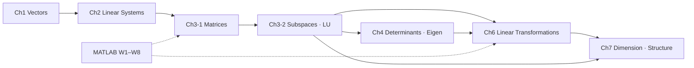

# LINEAR ALGEBRA

| 항목 | 내용 |
|---|---|
| 과목코드 | SED2103.01-00 |
| 담당교수 | 천세훈 |
| 학기 | 2026년 2학기 |
| 구분 | 교과 · 학부 |

## 📖 이 과목 학습 리포 사용법

강의 슬라이드·MATLAB 세션·과제를 바탕으로 정리한 **개념 노트**입니다. 장(Chapter) → 절(Section) 순서로 읽고, 절마다 정의·정리 → 설명 토글 → 증명 → 영상 → 혼동 개념 순서로 되어 있습니다.

1. 아래 코스 지도에서 절을 엽니다. 처음 보는 용어는 맨 위 🟨 **기초 Box**를 먼저 펼칩니다.
2. 정의·정리를 읽고 💡 **설명** 토글(뜻 · 왜 쓰나 · 작은 예 · 함정)로 확인합니다.
3. 📐 **증명** 링크와 🎬 **영상**은 막힐 때 봅니다.
4. 장을 끝내면 [Slide Discussion](시험대비/Discussion-슬라이드-토론문제.md)과 [Self-check](시험대비/Self-check.md)을 정답을 펼치기 전에 먼저 풉니다.
5. 다 읽은 절은 이 파일의 체크박스를 `[x]`로 바꿉니다.

| 구성 | 분량 | 위치 |
|---|---|---|
| 주차별 정리 | 1–13주차 · 이론 + MATLAB 세션 | [`수업요약/주차별/`](./수업요약/주차별) |
| 이론 개념 노트 | 7개 장 · 31개 절 | [`수업요약/`](./수업요약) |
| MATLAB 실습 | Week 1–8 · 13개 노트 | [`수업요약/MATLAB/`](./수업요약/MATLAB) |
| 증명과 풀이 | 22개 | [`수업요약/증명과-풀이/`](./수업요약/증명과-풀이) |
| 정리·정의 대시보드 | 139개 | [`시험대비/`](./시험대비) |
| Discussion · Self-check | 116문항 · 132문항 | [`시험대비/`](./시험대비) |
| 영상 지도 · 참고문헌 | 개념별·절별 | [`강의자료/`](./강의자료) |

> [!NOTE]
> 노트는 GitHub와 Obsidian 모두에서 읽히도록 일반 Markdown 링크, `<details>` 토글, GitHub alert(`> [!NOTE]`)로 썼습니다. 리포 폴더를 Obsidian vault로 열면 그래프 뷰로 개념 연결을 볼 수 있습니다. M8의 수식 블록(```math)은 GitHub 기준이라 Obsidian에서는 코드로 보입니다.

## 🗺 코스 지도



### Ch1 Vectors — 벡터

<sub>Chapter1_2026.pdf · 25쪽 · [장 목차](수업요약/Ch1_Vectors/README.md)</sub>

- [ ] [1.0 왜 Linear Algebra인가](수업요약/Ch1_Vectors/1.0_왜-Linear-Algebra인가.md)
- [ ] [1.1 벡터 연산과 Rⁿ](수업요약/Ch1_Vectors/1.1_벡터-연산과-Rⁿ.md)
- [ ] [1.2 Dot product와 orthogonality](수업요약/Ch1_Vectors/1.2_Dot-product와-orthogonality.md)
- [ ] [1.3 직선과 평면의 벡터방정식](수업요약/Ch1_Vectors/1.3_직선과-평면의-벡터방정식.md)

### Ch2 Systems of Linear Equations — 연립일차방정식

<sub>Chapter2_2026.pdf · 33쪽 · [장 목차](수업요약/Ch2_Systems-of-Linear-Equations/README.md)</sub>

- [ ] [2.1 Linear systems](수업요약/Ch2_Systems-of-Linear-Equations/2.1_Linear-systems.md)
- [ ] [2.2 Row reduction](수업요약/Ch2_Systems-of-Linear-Equations/2.2_Row-reduction.md)
- [ ] [2.3 Polynomial interpolation](수업요약/Ch2_Systems-of-Linear-Equations/2.3_Polynomial-interpolation.md)

### Ch3-1 Matrices and Matrix Algebra (1) — 행렬과 행렬대수 §3.1–3.3

<sub>Chapter3-1_2026.pdf · 46쪽 · [장 목차](수업요약/Ch3-1_Matrices-and-Matrix-Algebra/README.md)</sub>

- [ ] [3.1 Operations on matrices](수업요약/Ch3-1_Matrices-and-Matrix-Algebra/3.1_Operations-on-matrices.md)
- [ ] [3.2 Inverses와 대수 성질](수업요약/Ch3-1_Matrices-and-Matrix-Algebra/3.2_Inverses와-대수-성질.md)
- [ ] [3.3 Elementary matrices와 A⁻¹ 구하기](수업요약/Ch3-1_Matrices-and-Matrix-Algebra/3.3_Elementary-matrices와-A⁻¹-구하기.md)

### Ch3-2 Subspaces, Geometry, Special Matrices, LU — §3.4–3.8

<sub>Chapter3-2_2026.pdf · 66쪽 · [장 목차](수업요약/Ch3-2_Subspaces-Geometry-LU/README.md)</sub>

- [ ] [3.4 Subspaces와 linear independence](수업요약/Ch3-2_Subspaces-Geometry-LU/3.4_Subspaces와-linear-independence.md)
- [ ] [3.5 Geometry of linear systems](수업요약/Ch3-2_Subspaces-Geometry-LU/3.5_Geometry-of-linear-systems.md)
- [ ] [3.6 Special forms](수업요약/Ch3-2_Subspaces-Geometry-LU/3.6_Special-forms.md)
- [ ] [3.7 LU-decomposition](수업요약/Ch3-2_Subspaces-Geometry-LU/3.7_LU-decomposition.md)
- [ ] [3.8 Partitioned matrices](수업요약/Ch3-2_Subspaces-Geometry-LU/3.8_Partitioned-matrices.md)

### Ch4 Determinants and Eigenvalues — 행렬식과 고윳값 입문 §4.1, 4.2, 4.4

<sub>Chapter4_2026.pdf · 32쪽 · [장 목차](수업요약/Ch4_Determinants-and-Eigenvalues/README.md)</sub>

- [ ] [4.1 Determinant와 cofactor expansion](수업요약/Ch4_Determinants-and-Eigenvalues/4.1_Determinant와-cofactor-expansion.md)
- [ ] [4.2 Properties of determinants](수업요약/Ch4_Determinants-and-Eigenvalues/4.2_Properties-of-determinants.md)
- [ ] [4.4 Eigenvalues와 eigenvectors](수업요약/Ch4_Determinants-and-Eigenvalues/4.4_Eigenvalues와-eigenvectors.md)

### Ch6 Linear Transformations — 선형변환 §6.1–6.5

<sub>Chapter6-1·6-2_2026.pdf · 40+50쪽 · [장 목차](수업요약/Ch6_Linear-Transformations/README.md)</sub>

- [ ] [6.1 Matrices as transformations](수업요약/Ch6_Linear-Transformations/6.1_Matrices-as-transformations.md)
- [ ] [6.2 Geometry of linear operators](수업요약/Ch6_Linear-Transformations/6.2_Geometry-of-linear-operators.md)
- [ ] [6.3 Kernel and range](수업요약/Ch6_Linear-Transformations/6.3_Kernel-and-range.md)
- [ ] [6.4 Composition and invertibility](수업요약/Ch6_Linear-Transformations/6.4_Composition-and-invertibility.md)
- [ ] [6.5 Computer graphics](수업요약/Ch6_Linear-Transformations/6.5_Computer-graphics.md)

### Ch7 Dimension and Structure — 차원과 구조 §7.1–7.5, 7.7, 7.9–7.10

<sub>Chapter7-1·7-2_2026.pdf · 64+31쪽 · [장 목차](수업요약/Ch7_Dimension-and-Structure/README.md)</sub>

- [ ] [7.1 Basis and dimension](수업요약/Ch7_Dimension-and-Structure/7.1_Basis-and-dimension.md)
- [ ] [7.2 Properties of bases](수업요약/Ch7_Dimension-and-Structure/7.2_Properties-of-bases.md)
- [ ] [7.3 The fundamental spaces of a matrix](수업요약/Ch7_Dimension-and-Structure/7.3_The-fundamental-spaces-of-a-matrix.md)
- [ ] [7.4 The dimension theorem and its implications](수업요약/Ch7_Dimension-and-Structure/7.4_The-dimension-theorem-and-its-implications.md)
- [ ] [7.5 The rank theorem and its implications](수업요약/Ch7_Dimension-and-Structure/7.5_The-rank-theorem-and-its-implications.md)
- [ ] [7.7 The projection theorem](수업요약/Ch7_Dimension-and-Structure/7.7_The-projection-theorem.md)
- [ ] [7.9 Orthonormal bases and the Gram–Schmidt process](수업요약/Ch7_Dimension-and-Structure/7.9_Orthonormal-bases-and-the-Gram–Schmidt-process.md)
- [ ] [7.10 QR-decomposition](수업요약/Ch7_Dimension-and-Structure/7.10_QR-decomposition.md)

### MATLAB 실습

<sub>[MATLAB 목차](수업요약/MATLAB/README.md)</sub>

- [ ] [M1 Introduction I: 환경, 변수, 연산](수업요약/MATLAB/M1_Introduction-I-환경-변수-연산.md)
- [ ] [M2 Introduction II: 상수, 난수, 타입, 논리, 함수, 파일](수업요약/MATLAB/M2_Introduction-II-상수-난수-타입-논리-함수-파일.md)
- [ ] [M3 Vectors and Matrices: 만들기, 인덱싱, 모양 바꾸기](수업요약/MATLAB/M3_Vectors-and-Matrices-만들기-인덱싱-모양-바꾸기.md)
- [ ] [M4 Operations: 함수, 집계, 배열 연산, 논리 인덱싱, 행렬곱](수업요약/MATLAB/M4_Operations-함수-집계-배열-연산-논리-인덱싱-행렬곱.md)
- [ ] [M5 Matrix tools and linear systems](수업요약/MATLAB/M5_Matrix-tools-and-linear-systems.md)
- [ ] [M6 9주차 (MATLAB Week 6): LU decomposition과 계산량](수업요약/MATLAB/M6_9주차-MATLAB-Week-6-LU-decomposition과-계산량.md)
- [ ] [M7 10주차 (MATLAB Week 7): Matrix Models](수업요약/MATLAB/M7_10주차-MATLAB-Week-7-Matrix-Models.md)
- [ ] [M7.1 Linear difference equation](수업요약/MATLAB/M7.1_Linear-difference-equation.md)
- [ ] [M7.2 Population migration](수업요약/MATLAB/M7.2_Population-migration.md)
- [ ] [M7.3 Leontief input-output model](수업요약/MATLAB/M7.3_Leontief-input-output-model.md)
- [ ] [M7.4 MATLAB: Week7_practice.m](수업요약/MATLAB/M7.4_MATLAB-Week7_practice.m.md)
- [ ] [M8 MATLAB Week 8 — Computer Graphics & Signals](수업요약/MATLAB/M8_Computer-Graphics-and-Signals.md)
- [ ] [MX 명령어 색인과 세션 연습 답안](수업요약/MATLAB/MX_명령어-색인과-세션-연습-답안.md)

## 🎯 시험대비

| 자료 | 용도 |
|---|---|
| [정리·정의 대시보드](시험대비/정리-정의-대시보드.md) | 번호 붙은 정의·정리 139개 + 시험 포인트 (open-note 시험용 색인) |
| [Slide Discussion](시험대비/Discussion-슬라이드-토론문제.md) | 슬라이드 토론 문항 116개, 장별 |
| [Self-check](시험대비/Self-check.md) | 자가 점검 132문항, 장별 |
| [정정·주의 목록](시험대비/정정-주의-목록.md) | 슬라이드·transcript 오류, 헷갈리는 표기 |
| [증명과 풀이](수업요약/증명과-풀이/README.md) | 정리 증명 22개 |

## 📚 강의자료

- [개념별 영상 지도](강의자료/개념별-영상-지도.md) · [절별 영상 재생목록](강의자료/절별-영상-재생목록.md)
- [자료 목록과 커버리지](강의자료/자료-커버리지.md) — 어떤 수업 자료를 어떻게 반영했는지
- [참고문헌](강의자료/참고문헌.md) — Anton & Busby, *Contemporary Linear Algebra* (슬라이드 절 번호 기준)

> [!WARNING]
> 강의 슬라이드·영상·시험지 원본은 교수님 저작물이라 올리지 않았습니다. Homework·채점 퀴즈·Midterm 풀이도 공개 리포라 제외했습니다([과제/README](과제/README.md)).

## 📝 주차별 수업 요약

주차별 이론·MATLAB 세션 정리는 [수업요약/주차별/](수업요약/주차별/README.md)에 있습니다. 이론의 주차 배정은 과제 마감일과 슬라이드 순서로 추정한 것이고, MATLAB 주차는 세션 파일 기준입니다.

| 주차 | 주제 | 요약 노트 | 비고 |
|---|---|---|---|
| 1 | Ch1 Vectors · MATLAB Intro I | [1–2주차](수업요약/주차별/01-02주차_벡터와-연립방정식.md) | [M1](수업요약/MATLAB/M1_Introduction-I-환경-변수-연산.md) |
| 2 | Ch2 Systems of Linear Equations · MATLAB Intro II | [1–2주차](수업요약/주차별/01-02주차_벡터와-연립방정식.md) | [M2](수업요약/MATLAB/M2_Introduction-II-상수-난수-타입-논리-함수-파일.md) |
| 3 | Ch3-1 행렬 연산 · Vectors and Matrices | [3–4주차](수업요약/주차별/03-04주차_행렬-연산과-역행렬.md) | [M3](수업요약/MATLAB/M3_Vectors-and-Matrices-만들기-인덱싱-모양-바꾸기.md) |
| 4 | Ch3-1 역행렬·elementary matrix · Operations | [3–4주차](수업요약/주차별/03-04주차_행렬-연산과-역행렬.md) | [M4](수업요약/MATLAB/M4_Operations-함수-집계-배열-연산-논리-인덱싱-행렬곱.md) |
| 5 | Ch3-2 subspace·독립·해의 기하 · Matrix tools | [5주차](수업요약/주차별/05주차_Subspace와-해의-기하.md) | [M5](수업요약/MATLAB/M5_Matrix-tools-and-linear-systems.md) |
| 6 | Ch3-2 special forms·LU | [6–7주차](수업요약/주차별/06-07주차_특수-행렬-LU-분할-행렬.md) | MATLAB 세션 없음 |
| 7 | Ch3-2 LU·partitioned | [6–7주차](수업요약/주차별/06-07주차_특수-행렬-LU-분할-행렬.md) | MATLAB 세션 없음 |
| 8 | **중간고사** | [8주차](수업요약/주차별/08주차_중간고사.md) | 2026-10-21 ~ 23 온라인 |
| 9 | Ch4 행렬식·고유값 · MATLAB Week 6 LU | [9주차](수업요약/주차별/09주차_행렬식과-고유값.md) | [M6](수업요약/MATLAB/M6_9주차-MATLAB-Week-6-LU-decomposition과-계산량.md) |
| 10 | Ch6-1 선형변환 · MATLAB Week 7 Matrix Models | [10주차](수업요약/주차별/10주차_선형변환과-matrix-models.md) | [M7](수업요약/MATLAB/M7_10주차-MATLAB-Week-7-Matrix-Models.md) |
| 11 | Ch6-2 kernel·range·그래픽스 · MATLAB Week 8 | [11주차](수업요약/주차별/11주차_Kernel-range-합성-그래픽스.md) | [M8](수업요약/MATLAB/M8_Computer-Graphics-and-Signals.md) |
| 12 | Ch7-1 차원·구조 | [12–13주차](수업요약/주차별/12-13주차_차원-구조-정사영-QR.md) | MATLAB 세션 없음 |
| 13 | Ch7-2 정사영·QR | [12–13주차](수업요약/주차별/12-13주차_차원-구조-정사영-QR.md) | MATLAB 세션 없음 |
| 14 |  | | |
| 15 |  | | |
| 16 | **기말고사** | | |

## 📌 과제 · 시험 기록
| 구분 | 내용 | 마감/일자 | 링크 |
|---|---|---|---|
| 시험 | Midterm Exam (25문항 × 4점, open-note) | 2026-10-21 ~ 23 | |
