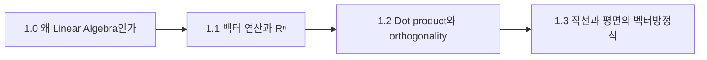

# Ch1 Vectors — 벡터

> Chapter 1 · 슬라이드 25쪽 · 연결 세션 Week 1–4

벡터는 크기와 방향을 함께 가진 양이며, Rⁿ에서는 성분의 나열로 일반화됩니다. 내적 하나로 길이, 거리, 각도, 직교가 모두 정의됩니다. <sub>〔Ch1 p.2–25〕</sub>



## 절 목록

- [ ] [1.0 왜 Linear Algebra인가](1.0_왜-Linear-Algebra인가.md) — 정의·정리 0개
- [ ] [1.1 벡터 연산과 Rⁿ](1.1_벡터-연산과-Rⁿ.md) — 정의·정리 5개
- [ ] [1.2 Dot product와 orthogonality](1.2_Dot-product와-orthogonality.md) — 정의·정리 12개
- [ ] [1.3 직선과 평면의 벡터방정식](1.3_직선과-평면의-벡터방정식.md) — 정의·정리 0개

## 문제

- [Slide Discussion 13문항](../../시험대비/Discussion-슬라이드-토론문제.md#ch1-vectors)
- [Self-check 6문항](../../시험대비/Self-check.md#ch1-vectors)

## MATLAB 연결 · 원문 보완

## MMATLAB 연결: 벡터 만들기와 계산

Week 1–2는 환경과 문법, Week 3–4는 벡터·행렬 조작입니다. 전체 정리는 종합 자료의 세션별 섹션에 있습니다.

```matlab
u = [-3 1 2 4 4];  v = [4 0 -8 1 2];    % 행벡터 (W3 02:00)
c = [1; 2; 3; 4];                       % 열벡터 (W3 10:00)
3*u, u+v, u-v                           % 스칼라배, 합, 차 (W4 11:30)
norm(u)                                 % 길이 [보완: 세션에 없음]
dot(u,v)                                % 내적 (W4 33:00)
u*v'                                    % 행벡터*열벡터 = 내적 (W4 31:20)
cross([4 2 5],[3 6 1])                  % 3차원 외적 (W4 33:40)
acosd(dot(u,v)/(norm(u)*norm(v)))       % 각도 [보완]
```

왜 벡터인가: 컴퓨터의 그래프는 연속선이 아니라 점의 나열이고, 그 점들을 벡터와 행렬로 표현합니다. <sub>〔W3 00:35〕</sub>

<details>
<summary>⚠️ 원문 보완·정정</summary>

- `보완` `norm`, `acosd`는 세션에서 다루지 않았습니다. 강의는 `sqrt(sum(u.^2))`를 조합해도 같은 값을 냅니다.
- `정정` HW1 Q2 문제는 "R⁴"라고 썼지만 u = (−2,1,0,3,5,1)은 성분이 6개입니다. Q3 문제는 "u and b"라고 썼지만 주어진 벡터는 u, v입니다.
- `보완` 슬라이드 그림(속도·힘·변위, 벡터 합)은 위 조작 도구로 재구성했습니다.

</details>

---
[과목 지도](../../README.md) · [Ch2 Systems of Linear Equations →](../Ch2_Systems-of-Linear-Equations/README.md)
