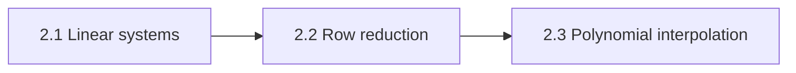

# Ch2 Systems of Linear Equations — 연립일차방정식

> Chapter 2 · 슬라이드 33쪽 · 연결 세션 Week 5

해 집합을 바꾸지 않는 row operation으로 augmented matrix를 RREF까지 줄이면 해를 바로 읽을 수 있습니다. 해의 개수는 0, 1, ∞ 중 하나입니다. <sub>〔Ch2 p.2–33〕</sub>



## 절 목록

- [ ] [2.1 Linear systems](2.1_Linear-systems.md) — 정의·정리 1개
- [ ] [2.2 Row reduction](2.2_Row-reduction.md) — 정의·정리 3개
- [ ] [2.3 Polynomial interpolation](2.3_Polynomial-interpolation.md) — 정의·정리 1개

## 문제

- [Slide Discussion 11문항](../../시험대비/Discussion-슬라이드-토론문제.md#ch2-systems-of-linear-equations)
- [Self-check 11문항](../../시험대비/Self-check.md#ch2-systems-of-linear-equations)

## MATLAB 연결 · 원문 보완

## MMATLAB 연결: Week 5 세 가지 풀이

Ax = b를 푸는 방법 세 가지와 각각의 용도입니다. <sub>〔W5 17:00–36:30〕</sub>

| 방법 | 코드 | 조건·특징 |
|---|---|---|
| 역행렬 | `x = inv(A)*b` | det(A) ≠ 0일 때만. 비용이 큽니다. |
| Backslash | `x = A\b` | 빠르고 정확합니다. 내부 알고리즘은 행렬 유형에 따라 최적화됩니다. |
| RREF | `rref([A b])` | 해 없음·무한을 구별할 수 있는 유일한 방법입니다. |

```matlab
A = [1 3 0; 2 1 3; 4 2 3];  b = [1; 6; 3];
det(A)                 % 0이 아닌지 먼저 확인
x1 = inv(A)*b
x2 = A\b
M  = [A b];            % augmented matrix (행렬을 옆으로 붙임)
R  = rref(M)
x3 = R(:,end)          % 마지막 열 = 해 (-2, 1, 3)
```

교수님의 핵심 비교: `inv`와 `\`는 수치 해를 주지만, det = 0일 때 해가 없는지 무한한지는 알려 주지 않습니다. RREF의 마지막 행이 \[0 0 | 1\]이면 해 없음, \[0 0 | 0\]이면 해 무한입니다. <sub>〔W5 13:57–36:30〕</sub>

Symbolic Math Toolbox의 `solve`도 있다고 소개했으나 이번 세션은 행렬 표현만 다룹니다. <sub>〔W5 01:33〕</sub>

```matlab
x = [1 2 3 4]';  y = [3 -2 -5 0]';     % Example 7
V = [x.^0 x.^1 x.^2 x.^3];             % Vandermonde (열 단위 계산)
a = V\y                                % [4; 3; -5; 1]
```

`보완` 보간 코드는 세션에 없고, 슬라이드 Example 7을 Week 4–5 문법으로 옮긴 것입니다.

<details>
<summary>⚠️ 원문 보완·정정</summary>

- `정정` Midterm Q10은 "[Theorem 2.2.1](2.2_Row-reduction.md#thm-221)"이라 적었지만, 슬라이드에서 해가 0·1·∞개라는 정리는 [Theorem 2.1.1](2.1_Linear-systems.md#thm-211)입니다.
- `보완` Ex 2의 풀이는 슬라이드에 없습니다. 값은 (x, y) = (7/3, 4/3)이며 도구로 확인할 수 있습니다.
- `보완` Midterm Q14가 인용한 "Example 8 of Section 2.3"은 슬라이드에 없습니다.

</details>

---
[← Ch1 Vectors](../Ch1_Vectors/README.md) · [과목 지도](../../README.md) · [Ch3-1 Matrices and Matrix Algebra (1) →](../Ch3-1_Matrices-and-Matrix-Algebra/README.md)
