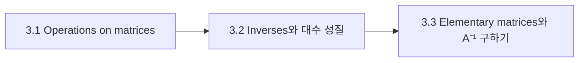

# Ch3-1 Matrices and Matrix Algebra (1) — 행렬과 행렬대수 §3.1–3.3

> Chapter 3 (1) · 슬라이드 46쪽 · 연결 세션 Week 3–5

행렬곱은 열벡터의 linear combination이고, row operation은 왼쪽 곱셈이며, invertibility는 여섯 가지 명제가 동치인 하나의 성질입니다. 〔Ch3-1 p.2–46〕

## 절 목록

- [ ] [3.1 Operations on matrices](3.1_Operations-on-matrices.md) — 정의·정리 9개
- [ ] [3.2 Inverses와 대수 성질](3.2_Inverses와-대수-성질.md) — 정의·정리 11개
- [ ] [3.3 Elementary matrices와 A⁻¹ 구하기](3.3_Elementary-matrices와-A⁻¹-구하기.md) — 정의·정리 6개

## 증명과 풀이

- [Thm 3.2.6, 3.2.8, 3.2.11 — 증명](../증명과-풀이/Thm-3.2.6-3.2.8-3.2.11-—-증명.md)
- [Thm 3.3.3 순환 증명, Thm 3.3.8(b) — 증명](../증명과-풀이/Thm-3.3.3-순환-증명-Thm-3.3.8-b-—-증명.md)

## 문제

- [Slide Discussion 12문항](../../시험대비/Discussion-슬라이드-토론문제.md#ch3-1-matrices-and-matrix-algebra-1)
- [Self-check 21문항](../../시험대비/Self-check.md#ch3-1-matrices-and-matrix-algebra-1)

## 들어가기

🟨 기초 Box — 처음 보는 용어 풀이

| 기호 | 읽는 법 | 뜻 |
|---|---|---|
| aᵢⱼ, (A)ᵢⱼ | a-i-j | i번째 row, j번째 column의 숫자. a₂₃ = 2행 3열 |
| A = \[aᵢⱼ\]ₘₓₙ | m by n | row m개, column n개 |
| Rⁿ | R-n | 숫자 n개짜리 vector 전체 (R² 평면, R³ 공간) |
| Aᵀ | A transpose | 행과 열을 맞바꾼 행렬 |
| A⁻¹ | A inverse | A를 되돌리는 행렬 (1/a 역할) |
| I, Iₙ | identity | 대각선 1, 나머지 0 (숫자 1 역할) |
| 0 | zero matrix | 모든 성분이 0 (숫자 0 역할) |
| tr(A) | trace | 정사각 행렬의 대각선 합 |
| ⇒ | implies | P이면 Q (한 방향) |
| ⇔, iff | if and only if | 양방향. 동시에 참이거나 동시에 거짓 |
| ∈ | in | b ∈ Rⁿ: b는 Rⁿ에 속함 |
| ⋯ | and so on | 같은 패턴이 계속됨 |

크기를 말할 때는 항상 행 먼저, 열 나중입니다. 2×3은 row 2개, column 3개입니다.

## MATLAB 연결 · 원문 보완

## MMATLAB 연결: 행렬 다루기 Week 3–5

| 구분 | 코드 | 결과·주의 | 출처 |
|---|---|---|---|
| 생성 | `[4 3 1; 2 5 6]`, `[2:4; 3:5]` | 세미콜론은 행 구분, 행마다 길이가 같아야 함 | 〔W3 12:45〕 |
| 특수 행렬 | `zeros(3)`, `ones(2,4)`, `eye(4)` | eye는 정방 단위행렬 | 〔W3 16:30, W5 09:24〕 |
| 전치 | `A'` | 행벡터 ↔ 열벡터 | 〔W3 10:43〕 |
| 대각·trace | `diag(A)`, `diag(v)`, `trace(A)`, `sum(diag(A))` | diag는 입력에 따라 추출 또는 생성 | 〔W5 05:27–08:46〕 |
| 행렬곱 | `A*B` | 안쪽 크기 일치 필요 | 〔W4 29:38〕 |
| 성분별 | `A.*B`, `A./B`, `A.^2` | 크기가 같아야 함. A\*B와 다름 | 〔W4 13:37〕 |
| 역행렬 | `inv(A)` | singular이면 경고 + Inf | 〔W5 11:44〕 |
| 행렬식 | `det(A)` | 0이면 singular | 〔W5 13:15〕 |
| 역 알고리즘 | `R = rref([A eye(size(A))]); X = R(:,4:6)` | \[A I\] → \[I A⁻¹\] | 〔W5 29:41〕 |

정리: 행렬곱 `A*B`, 성분별 곱 `A.*B`, `B*A`는 정사각이어도 모두 다른 값입니다. 〔W4 30:18〕

⚠️ 원문 보완·정정

- `보완` Example 3의 답은 슬라이드에 p.41로 나옵니다: A⁻¹ = \[−40 16 9; 13 −5 −3; 5 −2 −1\].
- `보완` Ex 4는 RREF에 영행이 생기며 왼쪽이 I가 되지 않습니다. 위 도구의 "Ch3 Ex 4 특이"에서 확인합니다.
- `정정` 번호 3.3.7이 슬라이드에 없습니다(3.3.6 → 3.3.8). 생략된 정리이며 내용 누락은 아닙니다.

---
[← Ch2 Systems of Linear Equations](../Ch2_Systems-of-Linear-Equations/README.md) · [과목 지도](../../README.md) · [Ch3-2 Subspaces, Geometry, Special Matrices, LU →](../Ch3-2_Subspaces-Geometry-LU/README.md)
