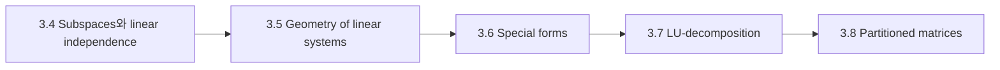

# Ch3-2 Subspaces, Geometry, Special Matrices, LU — §3.4–3.8

> Chapter 3 (2) · 슬라이드 66쪽 · 연결 세션 Week 5, 9주차(MATLAB Week 6)

해 공간은 subspace이고, Ax = b의 해 집합은 그 평행이동입니다. 구조가 있는 행렬(삼각, 대각, 대칭, 블록)은 계산을 크게 줄입니다. <sub>〔Ch3-2 p.2–66〕</sub>



## 절 목록

- [ ] [3.4 Subspaces와 linear independence](3.4_Subspaces와-linear-independence.md) — 정의·정리 8개
- [ ] [3.5 Geometry of linear systems](3.5_Geometry-of-linear-systems.md) — 정의·정리 5개
- [ ] [3.6 Special forms](3.6_Special-forms.md) — 정의·정리 0개
- [ ] [3.7 LU-decomposition](3.7_LU-decomposition.md) — 정의·정리 2개
- [ ] [3.8 Partitioned matrices](3.8_Partitioned-matrices.md) — 정의·정리 0개

## 증명과 풀이

- [Thm 3.4.3, 3.4.6 — 증명](../증명과-풀이/Thm-3.4.3-3.4.6-—-증명.md)
- [Thm 3.5.1 증명, b ≠ 0 주의 — 증명](../증명과-풀이/Thm-3.5.1-증명-b-≠-0-주의-—-증명.md)
- [Thm 3.6.4, 3.6.5, 3.6.6 근거 — 증명](../증명과-풀이/Thm-3.6.4-3.6.5-3.6.6-근거-—-증명.md)

## 문제

- [Slide Discussion 16문항](../../시험대비/Discussion-슬라이드-토론문제.md#ch3-2-subspaces-geometry-special-matrices-lu)
- [Self-check 24문항](../../시험대비/Self-check.md#ch3-2-subspaces-geometry-special-matrices-lu)

## MATLAB 연결 · 원문 보완

## MMATLAB 연결: 9주차 파일 = LearnUs "MATLAB Week 6"

```matlab
A = [6 -2 0; 9 -1 1; 3 7 5];
format rat                  % 분수로 표시
[L, U, P] = lu(A)           % PA = LU
%  L = [1 0 0; 1/3 1 0; 2/3 -2/11 1]
%  U = [9 -1 1; 0 22/3 14/3; 0 0 2/11]
%  P = [0 1 0; 0 0 1; 1 0 0]
format short                % 표시 복원

A = [2 6 2; -3 -8 0; 4 9 2];  b = [2; 2; 3];
[L, U, P] = lu(A);
y = L \ (P*b);              % forward: L y = P b
x = U \ y                   % back: U x = y → [2; -1; 2]
c1 = U \ (L \ (P*[1;0;0])); % A⁻¹의 1열 = [-8/7; 3/7; 5/14]
x = A\b                     % 일반 정방행렬의 "lazy" 풀이
```

| Example 2 | 손계산 | MATLAB `lu` |
|---|---|---|
| 대각 1 | U | L |
| 행 교환 | 없음 | partial pivoting, P에 기록 |
| 첫 pivot | 6 | 9 |
| 식 | A = LU | PA = LU |

Partial pivoting: 각 열에서 절댓값이 가장 큰 성분을 row interchange로 pivot 자리에 옮겨 round-off error를 줄입니다. 교수님은 시험 출제를 언급했고 실제로 Midterm Q4에 나왔습니다. <sub>〔Ch3-2 W9 슬라이드 12 · W9 24:45〕</sub>

`[L,U] = lu(A)`는 row-permuted matrix PᵀL을 돌려줍니다. 이 경우 A = LU가 바로 성립하지만, 교수님은 항상 P를 받는 형태를 권장합니다. <sub>〔W9 26:08〕</sub>

L, U, P를 한 번 구하면(≈ (2/3)n³) 우변마다 삼각 풀이 2번(≈ 2n²)이면 됩니다. <sub>〔W9 슬라이드 13 · W9 29:54〕</sub>

```matlab
% 독립성 판정 (Week 5 문법)
A = [1 2 3; 2 5 3; 1 0 8];      % 열이 v1 v2 v3
rref(A)                         % I이면 independent
% 해공간과 행벡터의 직교
null(A,'r')                     % [보완] 세션에 없는 함수
```

<details>
<summary>⚠️ 원문 보완·정정</summary>

- `보완` LDU-decomposition은 슬라이드에 없고 HW3-2 Q9에만 나옵니다. A = LDU에서 L, U는 대각 1, D는 pivot 대각행렬입니다.
- `보완` Exercise (c)의 네 벡터는 [Thm 3.4.8](3.4_Subspaces와-linear-independence.md#thm-348)의 예입니다.
- `정정` LU의 "역행렬이 cheap"은 banded 등 구조가 있을 때 효과가 큽니다. 꽉 찬 행렬에서는 교수님도 "roughly same"이라고 설명합니다. <sub>〔W9 10:24, 29:15〕</sub>
- `정정` Transcript는 back/forward를 섞어 말합니다. L을 푸는 쪽이 forward, U를 푸는 쪽이 back입니다.
- `정정` 번호 3.5.4는 슬라이드에 없습니다(3.5.3 → 3.5.5).
- `정정` 이전에 만든 LU 페이지는 음성 없이 필기만 보고 "n = 10³"이라 추정했습니다. Transcript 기준으로 기준점은 10×10이고 n은 10⁴로 늘린 것입니다.

</details>

---
[← Ch3-1 Matrices and Matrix Algebra (1)](../Ch3-1_Matrices-and-Matrix-Algebra/README.md) · [과목 지도](../../README.md) · [Ch4 Determinants and Eigenvalues →](../Ch4_Determinants-and-Eigenvalues/README.md)
