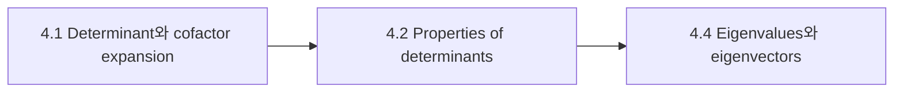

# Ch4 Determinants and Eigenvalues — 행렬식과 고윳값 입문 §4.1, 4.2, 4.4

> Chapter 4 · 슬라이드 32쪽 · MATLAB 세션 없음( det 만 Week 5)

det(A)는 행렬이 invertible인지 판정하는 하나의 수이고, 2×2에서는 넓이 배율입니다. det(λI − A) = 0으로 eigenvalue를 구합니다. <sub>〔Ch4 p.2–32〕</sub>



## 절 목록

- [ ] [4.1 Determinant와 cofactor expansion](4.1_Determinant와-cofactor-expansion.md) — 정의·정리 4개
- [ ] [4.2 Properties of determinants](4.2_Properties-of-determinants.md) — 정의·정리 6개
- [ ] [4.4 Eigenvalues와 eigenvectors](4.4_Eigenvalues와-eigenvectors.md) — 정의·정리 6개

## 증명과 풀이

- [Example 4 두 방향 전개, Example 5 단계 — 풀이](../증명과-풀이/Example-4-두-방향-전개-Example-5-단계-—-풀이.md)
- [Thm 4.2.3, 4.2.6 — 증명](../증명과-풀이/Thm-4.2.3-4.2.6-—-증명.md)
- [Example 2, 3 — 풀이](../증명과-풀이/Example-2-3-—-풀이.md)

## 문제

- [Slide Discussion 10문항](../../시험대비/Discussion-슬라이드-토론문제.md#ch4-determinants-and-eigenvalues)
- [Self-check 11문항](../../시험대비/Self-check.md#ch4-determinants-and-eigenvalues)

## 들어가기

<details>
<summary>🟨 기초 Box — 처음 보는 용어 풀이</summary>

- **Square matrix** — 행 수 = 열 수. det는 정방행렬에만 정의됩니다.
- **Entry aᵢⱼ** — i행 j열의 숫자입니다.
- **Main diagonal** — a₁₁, a₂₂, …, aₙₙ
- **Transpose** — 행과 열을 맞바꿉니다. 주대각선은 그대로입니다.
- **Identity Iₙ** — 대각선 1, 나머지 0. det(I) = 1
- **Inverse** — AA⁻¹ = I. 있으면 invertible, 없으면 singular
- **Triangular** — 대각선 아래가 0이면 upper, 위가 0이면 lower. 둘 다면 diagonal
- **Scalar k** — 보통 숫자 하나. kA는 모든 성분에 k를 곱합니다.
- **Ax** — A가 벡터 x를 다른 벡터로 바꾸는 계산. \[1 3; 4 2\](1,1) = (4,6)
- **Linear independence** — 어떤 벡터도 나머지의 조합으로 만들 수 없는 상태
- **Trivial solution** — Ax = 0의 x = 0. 0이 아닌 해는 nontrivial
- **Row operations** — ① 두 행 교환 ② 한 행에 0 아닌 수 곱 ③ 한 행의 배수를 다른 행에 더함
- **RREF** — 행 연산으로 최대한 정리한 모양. 정방행렬의 RREF가 I이면 가역
- **Trace** — 주대각선의 합. tr(\[1 3; 4 2\]) = 3
- **Symmetric** — Aᵀ = A
- **(−1)^(i+j)** — i + j가 짝수면 +1, 홀수면 −1. 체스판 + − + / − + − / + − +
- **Polynomial · root** — λ² − 3λ − 10을 0으로 만드는 λ가 근. 인수분해 (λ−5)(λ+2)
- **⇔ · equivalent** — 목록 전체가 함께 참이거나 함께 거짓
- **Vector** — 숫자를 한 줄로 세운 것. 평면에서는 화살표

</details>

## MATLAB 연결 · 원문 보완

## MMATLAB 연결

Chapter 4 전용 세션은 폴더에 없습니다. `det`는 Week 5에서 inverse 존재 판정용으로 다뤘습니다. <sub>〔W5 13:15〕</sub>

```matlab
A = [1 2 3; -4 5 6; 7 -8 9];
det(A)                     % 240 (Week 5)
det(A'), det(2*A)          % Thm 4.2.1, 4.2.3 확인: 240, 8*240
B = [1 3; 4 2];
[V, D] = eig(B)            % [보완] eigenvector 열, eigenvalue 대각
prod(diag(D)), det(B)      % λ의 곱 = det
sum(diag(D)),  trace(B)    % λ의 합 = trace
```

`보완` `eig`는 강의 자료에 없는 함수입니다.

<details>
<summary>⚠️ 원문 보완·정정</summary>

- `보완` §4.3은 슬라이드에 없습니다. 정리 번호 4.4.1–2, 4.4.6, 4.4.8–10도 슬라이드에 없습니다.
- `보완` Example 2, 3, 4, 6의 풀이값은 슬라이드에 답이 없어 계산으로 채웠습니다. Example 2는 슬라이드 그림 설명과 일치합니다.
- `보완` p.4 Example 2의 두 번째 행렬은 하삼각 4×4로, 대각 1, 9, −1, −2의 곱 18입니다.

</details>

---
[← Ch3-2 Subspaces, Geometry, Special Matrices, LU](../Ch3-2_Subspaces-Geometry-LU/README.md) · [과목 지도](../../README.md) · [Ch6 Linear Transformations →](../Ch6_Linear-Transformations/README.md)
