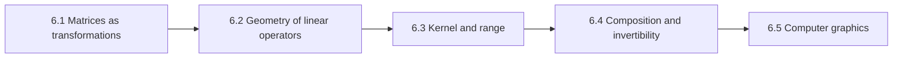

# Ch6 Linear Transformations — 선형변환 §6.1–6.5

> Chapter 6 · 슬라이드 6-1 40쪽 + 6-2 50쪽 · MATLAB 세션 없음

행렬 A는 벡터 x를 Ax로 보내는 함수입니다. 선형변환은 모두 이런 행렬 곱으로 쓸 수 있고, 그 행렬의 열은 T(e₁), T(e₂), …입니다. 길이를 보존하는 연산자는 직교행렬에 대응합니다. 6-2에서는 0으로 가는 벡터(kernel)와 도달하는 벡터(range)로 one-to-one·onto를 판정하고, 합성은 행렬 곱 BA, 역변환은 A⁻¹이 됩니다. 마지막으로 그래픽의 이동을 homogeneous coordinates로 행렬 곱에 넣습니다. <sub>〔Ch6 p.2–40〕</sub> <sub>〔Ch6-2 p.1–50〕</sub>



## 절 목록

- [ ] [6.1 Matrices as transformations](6.1_Matrices-as-transformations.md) — 정의·정리 4개
- [ ] [6.2 Geometry of linear operators](6.2_Geometry-of-linear-operators.md) — 정의·정리 6개
- [ ] [6.3 Kernel and range](6.3_Kernel-and-range.md) — 정의·정리 13개
- [ ] [6.4 Composition and invertibility](6.4_Composition-and-invertibility.md) — 정의·정리 4개
- [ ] [6.5 Computer graphics](6.5_Computer-graphics.md) — 정의·정리 2개

## 증명과 풀이

- [Thm 6.1.3, 6.1.4 증명, Rθ 유도 — 증명](../증명과-풀이/Thm-6.1.3-6.1.4-증명-Rθ-유도-—-증명.md)
- [Thm 6.2.1, 6.2.3, Ex 4 — 증명](../증명과-풀이/Thm-6.2.1-6.2.3-Ex-4-—-증명.md)
- [Thm 6.3.2, 6.3.11, 6.3.14 — 증명](../증명과-풀이/Thm-6.3.2-6.3.11-6.3.14-—-증명.md)
- [Thm 6.4.1, 6.4.2 증명과 Ex 12 검산 — 증명](../증명과-풀이/Thm-6.4.1-6.4.2-증명과-Ex-12-검산-—-증명.md)
- [Ex 3 계산과 Ex 7 순서 비교 — 풀이](../증명과-풀이/Ex-3-계산과-Ex-7-순서-비교-—-풀이.md)

## 문제

- [Slide Discussion 18문항](../../시험대비/Discussion-슬라이드-토론문제.md#ch6-linear-transformations)
- [Self-check 21문항](../../시험대비/Self-check.md#ch6-linear-transformations)

## MATLAB 연결 · 원문 보완

## MMATLAB 연결: Example 6의 좌표 변환

Chapter 6을 다룬 비대면 세션은 폴더에 없습니다. 슬라이드 p.39의 절차만 코드로 옮긴 학습용 예시이며, 예시 값 θ = 30°, k = 0.5는 직접 정했습니다. `보완`

```matlab
% 2×N 행렬 P의 각 열이 pixel 좌표
R = [cosd(30) -sind(30); sind(30) cosd(30)];   % 회전
S = [1 0.5; 0 1];                              % x 방향 shear, k = 0.5
C = [0.5 0; 0 1];                              % x 방향 compression
Q = R * P;                                     % 변환된 좌표, gray level은 그대로 배정
```

<details>
<summary>⚠️ 원문 보완·정정</summary>

- `보완` 파일명은 Chapter6-1이고 범위는 §6.1–6.2입니다. Example 번호는 6.1에서 1, 2, 3, 7, 8, 10, 11, 6.2에서 1, 2, 4, 5, 6으로 건너뜁니다.
- `보완` Thm 6.2.4는 슬라이드에 없습니다.
- `보완` p.13, 16, 17, 33, 38, 40은 문제만 있어 풀이와 설명을 직접 작성했습니다.
- `보완` p.31의 H<sub>θ</sub>ᵀH<sub>θ</sub> = I는 "verify"로 남겨져 있습니다. 전개하면 cos²2θ + sin²2θ = 1, 비대각은 0입니다.
- `보완` 6-2의 번호는 Def 6.3.5, 6.3.8, Thm 6.4.3–6.4.4, Example 6.4의 2–11, 6.5의 4, 6이 슬라이드에 없습니다. Ex 1·4 (6.3)와 Ex 3 (6.5)는 문제만 있어 답을 직접 계산했습니다.
- `보완` 6-2 Discussion 두 세트(p.23, 37)는 답이 없어 직접 풀었습니다.
- `보완` Connectivity matrix의 대각 성분 1은 이 슬라이드의 약속입니다. 대각을 0으로 두는 교재도 있습니다.
- `보완` 슬라이드의 Einstein 사진은 옮기지 않았고 위젯의 F 도형으로 같은 변환을 보입니다.

</details>

---
[← Ch4 Determinants and Eigenvalues](../Ch4_Determinants-and-Eigenvalues/README.md) · [과목 지도](../../README.md) · [Ch7 Dimension and Structure →](../Ch7_Dimension-and-Structure/README.md)
