# Ch7 Dimension and Structure — 차원과 구조 §7.1–7.5, 7.7, 7.9–7.10

> Chapter 7 · 슬라이드 7-1 64쪽 + 7-2 31쪽 · MATLAB 세션 없음

```mermaid
flowchart LR
  S0["7.1 Basis and dimension"]
  S1["7.2 Properties of bases"]
  S2["7.3 The fundamental spaces of a matrix"]
  S3["7.4 The dimension theorem and its implications"]
  S4["7.5 The rank theorem and its implications"]
  S5["7.7 The projection theorem"]
  S6["7.9 Orthonormal bases and the Gram–Schmidt process"]
  S7["7.10 QR-decomposition"]
  S0 --> S1
  S1 --> S2
  S2 --> S3
  S3 --> S4
  S4 --> S5
  S5 --> S6
  S6 --> S7
```

Subspace를 "필요한 벡터만 남긴 생성 집합", 즉 basis로 묘사하고 그 개수를 dimension으로 정의합니다. 행렬 하나에는 row(A), col(A), null(A), null(Aᵀ)의 네 공간이 붙고, row(A) ⊥ null(A), col(A) ⊥ null(Aᵀ)입니다. 차원 사이에는 rank(A) + nullity(A) = n, rank(A) = rank(Aᵀ)가 성립하고, 이 두 식으로 Ax = b의 해 구조와 unifying theorem 18개 조건이 정리됩니다. 7-2에서는 벡터를 subspace W와 W⊥ 성분으로 나누는 projection theorem, 직교 basis를 만드는 Gram–Schmidt, 그 결과를 행렬로 쓴 A = QR과 least squares 풀이를 다룹니다. 〔Ch7 p.1–64〕 〔Ch7-2 p.1–31〕

## 절 목록

- [ ] [7.1 Basis and dimension](7.1_Basis-and-dimension.md) — 정의·정리 5개
- [ ] [7.2 Properties of bases](7.2_Properties-of-bases.md) — 정의·정리 4개
- [ ] [7.3 The fundamental spaces of a matrix](7.3_The-fundamental-spaces-of-a-matrix.md) — 정의·정리 6개
- [ ] [7.4 The dimension theorem and its implications](7.4_The-dimension-theorem-and-its-implications.md) — 정의·정리 3개
- [ ] [7.5 The rank theorem and its implications](7.5_The-rank-theorem-and-its-implications.md) — 정의·정리 4개
- [ ] [7.7 The projection theorem](7.7_The-projection-theorem.md) — 정의·정리 5개
- [ ] [7.9 Orthonormal bases and the Gram–Schmidt process](7.9_Orthonormal-bases-and-the-Gram–Schmidt-process.md) — 정의·정리 2개
- [ ] [7.10 QR-decomposition](7.10_QR-decomposition.md) — 정의·정리 2개

## 증명과 풀이

- [Thm 7.1.2, 7.1.4 증명 스케치 — 증명](../증명과-풀이/Thm-7.1.2-7.1.4-증명-스케치-—-증명.md)
- [Thm 7.2.1 증명과 Ex 2 계산 — 증명](../증명과-풀이/Thm-7.2.1-증명과-Ex-2-계산-—-증명.md)
- [Thm 7.3.3, 7.3.5 — 증명](../증명과-풀이/Thm-7.3.3-7.3.5-—-증명.md)
- [Thm 7.4.1이 성립하는 이유 — 증명](../증명과-풀이/Thm-7.4.1이-성립하는-이유-—-증명.md)
- [Thm 7.5.3, 7.5.6 이유 — 증명](../증명과-풀이/Thm-7.5.3-7.5.6-이유-—-증명.md)
- [Thm 7.7.4, 7.7.5, 7.7.7 이유 — 증명](../증명과-풀이/Thm-7.7.4-7.7.5-7.7.7-이유-—-증명.md)
- [Thm 7.9.1, 7.9.4와 Gram–Schmidt가 성립하는 이유 — 증명](../증명과-풀이/Thm-7.9.1-7.9.4와-Gram–Schmidt가-성립하는-이유-—-증명.md)
- [A = QR 구성과 Thm 7.10.2 — 증명](../증명과-풀이/A-=-QR-구성과-Thm-7.10.2-—-증명.md)

## 문제

- [Slide Discussion 36문항](../../시험대비/Discussion-슬라이드-토론문제.md#ch7-dimension-and-structure)
- [Self-check 17문항](../../시험대비/Self-check.md#ch7-dimension-and-structure)

---
[← Ch6 Linear Transformations](../Ch6_Linear-Transformations/README.md) · [과목 지도](../../README.md)
