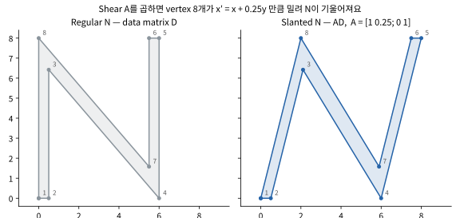
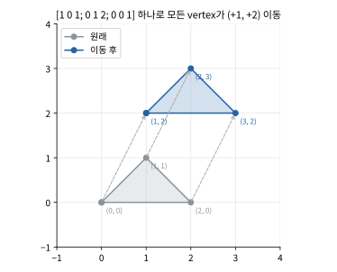
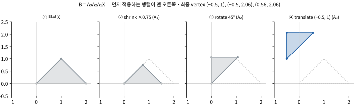
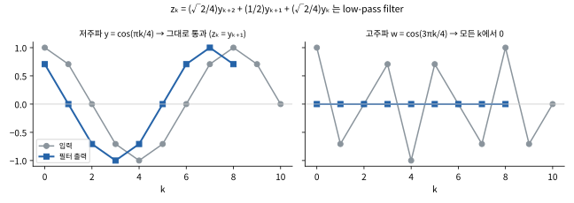
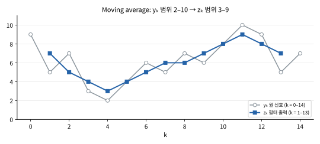

# M8 MATLAB Week 8 — Computer Graphics & Signals

> **주차** 11주차 (MATLAB Week 8 세션) · **강의 길이** 35:37 · 슬라이드 26장  
> **이론 연결** [6.5 Computer graphics](../Ch6_Linear-Transformations/6.5_Computer-graphics.md) · [6.4 Composition and invertibility](../Ch6_Linear-Transformations/6.4_Composition-and-invertibility.md) · [7.1 Basis and dimension](../Ch7_Dimension-and-Structure/7.1_Basis-and-dimension.md) · [M7.1 Linear difference equation](M7.1_Linear-difference-equation.md)

Week 8은 linear algebra를 **computer graphics**(0–19분)와 **signals**(19–35분)에 적용하는 강의예요. 핵심은 변환과 필터가 모두 **행렬 곱**으로 표현된다는 점이에요.

| 항목 | 내용 |
|---|---|
| Part 1 | Data matrix, homogeneous coordinates, composite transformations, Exercise 1·2 |
| Part 2 | Signal 정의, Casorati matrix, linear difference equation, Exercise 3 |
| 과제 | 강의 속 Exercise 전체가 homework로 출제됨 |

> [!IMPORTANT]
> **핵심 3줄**
> 1. Homogeneous coordinates를 쓰면 translation까지 행렬 곱 하나로 처리돼요. 곱하는 **순서**가 결과를 바꿔요(A₂A₁은 rotation, A₁A₂는 아님).
> 2. Signal은 sampling으로 얻은 수열이고, 신호들의 독립성은 **Casorati matrix**의 invertibility로 판정해요.
> 3. Moving average 같은 linear filter는 고주파 noise를 줄이는 **low-pass filter**이고, MATLAB vector indexing 한 줄로 구현돼요.

## Part 1. Computer Graphics

### 1. 도형을 data matrix로 표현하기 (0:00–4:40)

글자 같은 2D 기호는 **wire-frame** 객체로 저장돼요. 대문자 N은 **vertex 8개**와 이를 잇는 **edge**로 정해지고, vertex 좌표를 열로 모은 것이 data matrix D예요. D에 shear transformation A를 곱한 AD가 기울어진 N(italic)이에요.



<sub>좌표: Lay 교재 2.7절 예시 값 · shear 계수 0.25</sub>

### 2. Homogeneous Coordinates (4:40–10:45)

평면의 점 (x, y)를 3차원 점 (x, y, 1)로 다뤄요. 이렇게 하면 linear transformation이 아닌 **translation**도 행렬 곱으로 표현돼요.

```math
\begin{bmatrix}1&0&h\\0&1&k\\0&0&1\end{bmatrix}\begin{bmatrix}x\\y\\1\end{bmatrix}=\begin{bmatrix}x+h\\y+k\\1\end{bmatrix}
```

vertex 여러 개를 열로 묶어 한 번에 곱하고, edge는 변환된 vertex를 다시 이어 만들어요.



<sub>강의 슬라이드 7–8장 예시 · h = 1, k = 2</sub>

### 3. Composite Transformations (10:45–13:17)

먼저 적용하는 변환이 곱셈의 **맨 오른쪽**에 와요. 예시는 shrink 0.75 → rotate π/4 → translate (−0.5, 1)이고, 세 행렬을 미리 곱해 두면 행렬 하나로 한 번에 적용돼요.

```math
B = A_3A_2A_1X,\quad A_3A_2A_1=\begin{bmatrix}1&0&-.5\\0&1&1\\0&0&1\end{bmatrix}\begin{bmatrix}\cos\frac{\pi}{4}&-\sin\frac{\pi}{4}&0\\\sin\frac{\pi}{4}&\cos\frac{\pi}{4}&0\\0&0&1\end{bmatrix}\begin{bmatrix}.75&0&0\\0&.75&0\\0&0&1\end{bmatrix}
```

합친 행렬은 [0.53 −0.53 −0.5; 0.53 0.53 1; 0 0 1]이에요(numpy 재계산).



<sub>강의 슬라이드 9장 행렬 · 도형은 앞의 삼각형 (0,0), (1,1), (2,0)으로 그린 예시</sub>

### 4. Exercise 1 — 두 shear의 합성 = rotation (13:17–17:00)

A₁은 vertical shear 후 열 압축, A₂는 horizontal shear 후 행 확대예요. **A₂A₁은 각 φ의 rotation**이 되고, **A₁A₂는 rotation이 아니에요.**

```math
A_1=\begin{bmatrix}1&0&0\\\sin\varphi&\cos\varphi&0\\0&0&1\end{bmatrix},\quad A_2=\begin{bmatrix}\sec\varphi&-\tan\varphi&0\\0&1&0\\0&0&1\end{bmatrix},\quad A_2A_1=\begin{bmatrix}\cos\varphi&-\sin\varphi&0\\\sin\varphi&\cos\varphi&0\\0&0&1\end{bmatrix}
```

계산의 핵심은 sec φ − tan φ sin φ = (1 − sin²φ)/cos φ = cos φ예요. φ = π/6을 넣으면 [0.8660 −0.5000; 0.5000 0.8660]이 나와요.

<details>
<summary>💡 A₁A₂는 왜 rotation이 아닌가</summary>

φ = π/6에서 A₁A₂ = [1.1547 −0.5774; 0.5774 0.5774]예요(numpy 재계산). 열의 길이가 1이 아니라서 길이를 보존하지 않으므로 rotation이 아니에요. 행렬 곱은 교환법칙이 성립하지 않는다는 [3.2 Inverses와 대수 성질](../Ch3-1_Matrices-and-Matrix-Algebra/3.2_Inverses와-대수-성질.md)의 예이기도 해요.

</details>

### 5. Exercise 2 — RGB ↔ CIE XYZ (17:00–19:20)

화면 제조사는 RGB 데이터를 국제 표준 CIE XYZ와 서로 변환해야 해요. 문제는 XYZ에서 RGB를 구하는 것이에요(교수님이 강의 중 방향을 정정하셨어요).

```math
\begin{bmatrix}0.61&0.29&0.150\\0.35&0.59&0.063\\0.04&0.12&0.787\end{bmatrix}\begin{bmatrix}R\\G\\B\end{bmatrix}=\begin{bmatrix}X\\Y\\Z\end{bmatrix}
```

MATLAB에서는 `RGB = M \ XYZ`를 써요. M⁻¹을 따로 만들지 않고 XYZ의 열(프레임별 색 데이터) 전체를 한 번에 변환해요.

## Part 2. Signals

### 6. Signal과 sampling (19:20–24:10)

Signal은 모든 정수 k에 대한 무한 수열 {y<sub>k</sub>}예요. 예를 들어 δ는 한 점에서만 1이고, μ는 어느 시점부터 계속 1이에요.

- 연속 현상을 일정한 시간 간격으로 **sampling**하면 discrete signal이 돼요. 전기·제어공학, 생물학, 물리학, 경제학, 인구학에서 나와요.
- CD는 초당 **44,100번** 샘플링하고, 사람이 듣는 약 **20,000 Hz**까지의 주파수 정보를 담아요.
- 교수님 코멘트: 연속적으로 들리는 것은 뇌가 discrete 데이터를 이어 받아들이기 때문이에요.

### 7. Linear Independence of Signals (24:10–27:45)

신호 {u<sub>k</sub>}, {v<sub>k</sub>}, {w<sub>k</sub>}가 독립인지는 연속된 세 시점 k, k+1, k+2의 식을 행렬로 세워 판정해요. 이 계수 행렬이 **Casorati matrix**이고, 어느 k 하나에서라도 invertible이면 신호들은 linearly independent예요.

```math
\begin{bmatrix}u_k&v_k&w_k\\u_{k+1}&v_{k+1}&w_{k+1}\\u_{k+2}&v_{k+2}&w_{k+2}\end{bmatrix}\begin{bmatrix}c_1\\c_2\\c_3\end{bmatrix}=\begin{bmatrix}0\\0\\0\end{bmatrix}
```

예: 1<sup>k</sup>, (−2)<sup>k</sup>, 3<sup>k</sup>에서 k = 0이면 [1 1 1; 1 −2 3; 1 4 9] → [1 1 1; 0 −3 2; 0 0 10]으로 pivot이 3개라 invertible이고(det = −30), 따라서 독립이에요. 교수님은 실제 데이터에는 noise가 섞여 있어 이 판정을 그대로 적용하기 어렵다고 덧붙이셨어요.

> [!TIP]
> Casorati matrix가 invertible ⇔ 열이 independent는 [Unifying Theorem](../Ch3-1_Matrices-and-Matrix-Algebra/3.3_Elementary-matrices와-A⁻¹-구하기.md#unifying-theorem)의 같은 동치 관계예요.

### 8. Linear Difference Equation과 low-pass filter (27:45–30:07)

a₀y<sub>k+n</sub> + … + a<sub>n</sub>y<sub>k</sub> = z<sub>k</sub> 꼴의 식이고, z<sub>k</sub> = 0이면 homogeneous, 아니면 non-homogeneous예요. 예시 필터는 저주파는 통과시키고 고주파는 0으로 만드는 **low-pass filter**예요.

```math
\tfrac{\sqrt2}{4}y_{k+2}+\tfrac12y_{k+1}+\tfrac{\sqrt2}{4}y_k=z_k
```



<sub>강의 슬라이드 22–23장 필터식 · k = 0–10 샘플로 계산</sub>

고주파 성분은 대개 noise라서, 이런 필터로 원 데이터에서 noise를 걸러낼 수 있어요.

### 9. Exercise 3 — Moving average filter (30:07–35:37)

측정 noise를 줄이는 가장 단순한 필터는 양옆 값과 평균을 내는 **moving average**(sliding window)예요. y₀…y₁₄ = 9, 5, 7, 3, 2, 4, 6, 5, 7, 6, 8, 10, 9, 5, 7을 넣으면 z₁…z₁₃ = 7, 5, 4, 3, 4, 5, 6, 6, 7, 8, 9, 8, 7이 나와요.

```math
z_k=\tfrac13y_{k+1}+\tfrac13y_k+\tfrac13y_{k-1},\quad k=1,\dots,13
```



<sub>강의 Exercise 3 데이터 · y₀–y₁₄</sub>

진폭이 줄었다는 것은 고주파 성분이 줄었다는 뜻이고, 교수님은 이렇게 smoothing하는 것이 미분 전 단계로 쓰인다고 덧붙이셨어요.

> [!WARNING]
> MATLAB은 인덱스가 1부터 시작해요. y(1) = y₀이므로 z₁ = (y(1) + y(2) + y(3))/3이에요.

## MATLAB 코드 모음

강의 화면에 나온 코드를 그대로 옮겨 적었어요.

**Exercise 1 — symbolic으로 합성 확인**

```matlab
syms phi
A1 = [1 0 0; sin(phi) cos(phi) 0; 0 0 1];
A2 = [sec(phi) -tan(phi) 0; 0 1 0; 0 0 1];
A = simplify(A2*A1)   % [cos -sin 0; sin cos 0; 0 0 1]

% Symbolic Math Toolbox 없이
phi = pi/6;
A1 = [1 0 0; sin(phi) cos(phi) 0; 0 0 1];
A2 = [sec(phi) -tan(phi) 0; 0 1 0; 0 0 1];
A2*A1                 % [0.8660 -0.5000 0; 0.5000 0.8660 0; 0 0 1]
```

**Exercise 2 — XYZ → RGB**

```matlab
M = [0.61 0.29 0.150; 0.35 0.59 0.063; 0.04 0.12 0.787];
RGB = M \ XYZ;        % XYZ의 각 열 = 색 하나, inv(M) 없이 한 번에
```

**Exercise 3 — moving average**

```matlab
y = [9 5 7 3 2 4 6 5 7 6 8 10 9 5 7];   % y_0 ... y_14 (MATLAB은 y(1) = y_0)
z = (y(1:13) + y(2:14) + y(3:15)) / 3    % z_1 ... z_13
plot(0:14, y, 'o-', 1:13, z, 's-')
legend('y_k', 'z_k'), xlabel('k')
```

<sub>출처: 강의 영상(35:37) 음성 받아쓰기와 슬라이드 화면. Part 1의 N 좌표는 슬라이드에 숫자가 없어 Lay 교재 2.7절 예시 값을 썼어요. 그림은 같은 값으로 matplotlib에서 다시 그렸고, 수치는 numpy로 재계산해 확인했어요.</sub>

---
[← M7.4 MATLAB Week7\_practice.m](M7.4_MATLAB-Week7_practice.m.md) · [MATLAB 목차](README.md) · [과목 지도](../../README.md) · [MX 명령어 색인 →](MX_명령어-색인과-세션-연습-답안.md)
