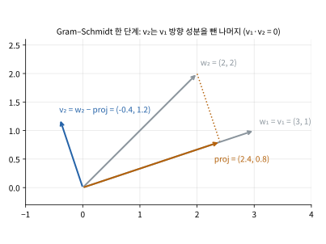

# 12–13주차 — 차원·구조, 정사영·QR

> **이번 주 개념 노트** [7.1 Basis and dimension](../Ch7_Dimension-and-Structure/7.1_Basis-and-dimension.md) · [7.2 Properties of bases](../Ch7_Dimension-and-Structure/7.2_Properties-of-bases.md) · [7.3 The fundamental spaces of a matrix](../Ch7_Dimension-and-Structure/7.3_The-fundamental-spaces-of-a-matrix.md) · [7.4 The dimension theorem and its implications](../Ch7_Dimension-and-Structure/7.4_The-dimension-theorem-and-its-implications.md) · [7.5 The rank theorem and its implications](../Ch7_Dimension-and-Structure/7.5_The-rank-theorem-and-its-implications.md) · [7.7 The projection theorem](../Ch7_Dimension-and-Structure/7.7_The-projection-theorem.md) · [7.9 Orthonormal bases and the Gram–Schmidt process](../Ch7_Dimension-and-Structure/7.9_Orthonormal-bases-and-the-Gram–Schmidt-process.md) · [7.10 QR decomposition](../Ch7_Dimension-and-Structure/7.10_QR-decomposition.md)  
> **MATLAB 노트** 세션 없음

## 이론: Ch7-1 §7.1–7.5 (p. 1–64)

Basis는 independent이면서 span하는 집합이고, 그 개수가 dimension이에요. m×n 행렬은 네 fundamental space를 가지고 rank 하나로 모든 차원이 정해져요.

```math
\mathrm{rank}(A) + \mathrm{nullity}(A) = n, \qquad \mathrm{null}(A) = \mathrm{row}(A)^{\perp}, \qquad \mathrm{null}(A^T) = \mathrm{col}(A)^{\perp}
```

| 공간 | 위치 | 차원 (rank k) | basis 찾기 |
|---|---|---|---|
| row(A) | Rn | k | REF의 0 아닌 행 |
| col(A) | Rm | k | **원래 A**의 pivot 열 |
| null(A) | Rn | n − k | free 변수마다 canonical 벡터 |
| null(Aᵀ) | Rm | m − k | Aᵀ의 해공간 |

- Consistency (Thm 7.5.3): Ax = b가 consistent ⇔ rank(A) = rank\[A | b\].
- Unifying theorem (Thm 7.4.4): n×n A에서 18개 조건이 모두 참이거나 모두 거짓. rank = n 하나로 판정해요.
- 함정: 행 연산은 row space와 null space를 보존하지만 column space는 바꿔요.

## 이론: Ch7-2 §7.7, 7.9, 7.10 (p. 1–31)

모든 벡터는 subspace W 성분과 W⊥ 성분으로 정확히 한 가지로 나눠져요 (Thm 7.7.4). Gram–Schmidt는 이 분해를 반복해 직교 basis를 만들고, 그 결과를 행렬로 쓴 것이 A = QR이에요.

```math
\mathrm{proj}_a x = \frac{x\cdot a}{\|a\|^2}a, \qquad P = M(M^TM)^{-1}M^T, \qquad v_j = w_j - \sum_{i \lt j}\frac{w_j\cdot v_i}{\|v_i\|^2}v_i
```

```math
A = QR,\ R = Q^TA, \qquad A^TA\hat{x} = A^Tb \iff R\hat{x} = Q^Tb
```



<sub>Gram–Schmidt 한 단계 · 설명용 R² 예 w₁ = (3, 1), w₂ = (2, 2) (슬라이드 예제 아님)</sub>

점선이 빼는 성분이고, 남은 v₂가 v₁과 직각을 이뤄요. R³에서는 v₃을 만들 때 v₁, v₂ 두 방향을 모두 빼요.

| 예제 | 답 (재계산 확인) |
|---|---|
| 7.7 Ex 2: x = (2, −1, 3), a = (4, −1, 2) | x₁ = (20/7, −5/7, 10/7), x₂ = (−6/7, −2/7, 11/7) |
| 7.7 Ex 6: 평면 x − 4y + 2z = 0 | P = (1/21)\[20 4 −2; 4 5 8; −2 8 17\], Px = (4/7, 12/7, 22/7) |
| 7.9 Ex 9: w = (1,1,1), (0,1,1), (0,0,1) | v₂ = (−2/3, 1/3, 1/3), v₃ = (0, −1/2, 1/2) |
| 7.10 Ex 1: A = \[1 0 0; 1 1 0; 1 1 1\] | R = \[√3 2/√3 1/√3; 0 2/√6 1/√6; 0 0 1/√2\] |
| 7.10 Ex 2: least squares | R = \[2 4 5; 0 2 3; 0 0 2\], Qᵀb = (1, −1, −4), x̂ = (1/2, 5/2, −2) |

7.10 Ex 2의 b는 원래 col(A) 안에 있어서 오차가 0이에요. 슬라이드에 §7.8은 없고, least squares는 7.10에서 다뤄요.

## MATLAB 세션: 없음

Ch7에는 MATLAB 세션이 없어요. 직접 확인할 때는 `rank`, `null(A,'r')`, `orth`, `[Q,R] = qr(A,0)`, `A\b`를 쓰면 돼요. MATLAB의 qr은 Q의 열과 R의 행 부호가 슬라이드와 반대일 수 있어요.

---
[← 11주차](11주차_Kernel-range-합성-그래픽스.md) · [주차별 목차](README.md) · [과목 지도](../../README.md)
